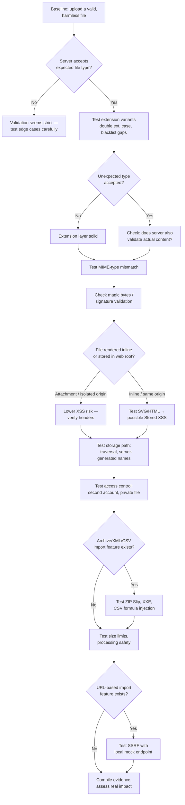

# File Upload Vulnerabilities — Practical Notes

> Detection-focused, evidence-based notes. Testing sirf authorized targets, bug bounty scope, ya legal practice labs (OWASP Juice Shop, local test apps, etc.) par karo. Har fixture harmless hona chahiye.

---

## Pehle Samjho: "Validation" ka Matlab Kya Hai?

Socho ek building ke guard ko instruction hai: *"sirf courier wale andar aane do."* Agar guard sirf ye dekhta hai ki banda **uniform** pehna hai, to koi bhi uniform pehen ke andar ghus sakta hai — asli courier ho ya na ho.

Website bhi aisa hi karti hai jab file upload accept karti hai. Agar wo sirf **filename ya label** dekhti hai (jaise `photo.jpg`) aur andar ka actual content check nahi karti, to koi bhi kisi bhi cheez ko `photo.jpg` naam dekar upload kar sakta hai.

**Yehi root cause hai har file-upload vulnerability ka:** server ne *label* trust kiya, *content* verify nahi kiya.

Is poore document me har section ek hi pattern follow karta hai:

1. **Kya galat assumption server kar raha hai?**
2. **Attacker us assumption ko kaise exploit karta hai?**
3. **Evidence kaise collect karo ki impact real hai (sirf "bypass hua" kehna kaafi nahi)?**

### Impact Rating — Kaise Padhein

Har vulnerability section me ek **Typical Impact** rating hai. Ye *default/typical* case batati hai — asli severity hamesha specific app, config, aur confirmed evidence par depend karti hai. Ek hi vulnerability type kisi app me High aur kisi me Low ho sakta hai.

| Rating | Matlab |
| --- | --- |
| 🔴 **High** | Attacker trusted boundary cross kar sakta hai — RCE, dusre users ka private data, ya poore system ka control |
| 🟠 **Medium** | Real security impact hai lekin limited scope — specific conditions chahiye, ya impact contained hai |
| 🟡 **Low** | Theoretical ya hygiene issue — exploit karna mushkil hai, ya impact minor hai (info leak jo sensitive na ho) |

> **Yaad rakho:** Rating tabhi upgrade hoti hai jab evidence prove kare — "bypass hua" ≠ "high impact". Section 20 (Assessment Table) isi logic ko detail me explain karta hai.

---

## Table of Contents

1. [What Is a File Upload Vulnerability?](#1-what-is-a-file-upload-vulnerability)
2. [Testing Flow (Diagram)](#2-testing-flow-diagram)
3. [Lab Setup](#3-lab-setup) 3.5. [Kyun Kuch Files "Execute" Hoti Hain](#35-kyun-kuch-files-execute-hoti-hain-aur-kuch-nahi)
4. [Extension Validation](#4-extension-validation)
5. [MIME-Type Validation](#5-mime-type-validation)
6. [Magic Bytes / File Signatures](#6-magic-bytes--file-signatures)
7. [SVG Upload & Stored XSS](#7-svg-upload--stored-xss)
8. [HTML Injection via Uploaded Files](#8-html-injection-via-uploaded-files)
9. [Path Traversal / Unsafe Storage Path](#9-path-traversal--unsafe-storage-path)
10. [Special Characters, Null Bytes, Encoding](#10-special-characters-null-bytes-encoding)
11. [IDOR / Broken Access Control on Files](#11-idor--broken-access-control-on-files)
12. [ZIP Slip & Decompression Bombs](#12-zip-slip--decompression-bombs)
13. [CSV Formula Injection](#13-csv-formula-injection)
14. [Unsafe Image Processing](#14-unsafe-image-processing)
15. [Upload Size Limits & Quotas](#15-upload-size-limits--quotas)
16. [SSRF via Remote-URL Import](#16-ssrf-via-remote-url-import)
17. [XXE in XML Uploads](#17-xxe-in-xml-uploads)
18. [HTTP PUT Method](#18-http-put-method)
19. [Open Redirect After Upload/Login](#19-open-redirect-after-uploadlogin)
20. [High-Impact Assessment Table](#20-high-impact-assessment-table)
21. [Prevention Checklist](#21-prevention-checklist)
22. [Quick Testing Checklist](#22-quick-testing-checklist)
23. [Bug Bounty Report Template](#23-bug-bounty-report-template)
24. [Real-World Reference](#24-real-world-reference)
25. [References](#25-references)

---

## 1. What Is a File Upload Vulnerability?

**Simple Definition:** Jab website user ko file upload karne deti hai, lekin file type, content, size, storage location ya access permissions ko properly validate nahi karti.

> **Analogy:** Ek dawa ki bottle par koi "Candy" likh de — bottle ka asli content dawa hi rahega, sirf **label** badla hai. Website agar sirf label (filename, extension, Content-Type) dekh ke decide karti hai ki file safe hai ya nahi, to attacker sirf label badal ke system ko confuse kar sakta hai.

**Root Cause:** Client-controlled data (filename, extension, MIME type) ko trust kar lena, bina actual file content independently verify kiye.

**Example:** Profile-photo feature sirf JPEG/PNG allow karna chahti hai, lekin weak validation ki wajah se HTML ya SVG bhi accept ho jaati hai.

**Potential Impact:**

- Stored Cross-Site Scripting (XSS)
- Remote Code Execution (RCE) — vulnerable server configs me
- Unauthorized private-file access (IDOR)
- Path Traversal
- ZIP Slip / decompression bombs
- Server-Side Request Forgery (SSRF) — URL-import flows me
- XXE — XML-based upload flows me
- Resource exhaustion / Denial of Service
- Sensitive information disclosure

> **Important:** File accept ho jaana apne aap me high-severity bug nahi hai. Impact ko safely, evidence ke saath demonstrate karna zaroori hai.

---

## 2. Testing Flow (Diagram)



---

## 3. Lab Setup

Ek intentionally vulnerable local application use karo — jaise OWASP Juice Shop, ya apna khud ka test upload app. Endpoint aur parameters har app me alag honge, example ko adapt karo.

**Example endpoint:**

```http
POST /upload HTTP/1.1
Host: localhost:3000
Content-Type: multipart/form-data; boundary=----LabBoundary
```

**Basic multipart body:**

```
------LabBoundary
Content-Disposition: form-data; name="file"; filename="photo.jpg"
Content-Type: image/jpeg

[TEST FILE CONTENT]
------LabBoundary--
```

Burp Suite se authorized lab requests intercept karke filename, MIME type, content, aur response observe karo.

---

## 3.5 Kyun Kuch Files "Execute" Hoti Hain Aur Kuch Nahi

Ye samajhna zaroori hai ki RCE (Remote Code Execution) tak baat kyu pahunch sakti hai — bina kisi exploit code ke, sirf mechanism samjho.

**Normal flow:** Jab web server kisi file ko request karta hai (e.g. `.jpg`), wo use **as-is** client ko bhej deta hai — raw bytes, koi processing nahi.

**Execution flow:** Jab web server `.php` (ya `.aspx`, `.jsp`, etc.) jaisi extension wali file request karta hai, wo use directly nahi bhejta. Pehle use ek **execution engine** (jaise Apache ke liye `mod_php`, ya Nginx ke saath PHP-FPM) ko pass karta hai. Ye engine file ke andar likhe gaye instructions ko **interpret aur run** karta hai — jo bhi commands file me hon — aur result (usually HTML) generate karta hai. Yehi HTML output client ko bhejta hai. Original code client ko kabhi dikhta nahi.

**Security implication:**

- Agar koi malicious `.php` file upload directory me pahunch jaye **aur** wo directory PHP engine se interpreted ho, to us file ke andar ka koi bhi instruction server par **run** ho sakta hai — yahi RCE ka root mechanism hai.
- Agar ulta ho — `.php` file kisi non-interpreted directory me pahunch jaye, ya renamed ho — to wo raw text ki tarah serve ho sakti hai, jisse **source code leak** ho sakta hai.

**Isliye "file accept hona" aur "file execute hona" do alag cheezein hain.** Pehla sirf upload-validation gap hai; dusra tab hota hai jab (a) file server-interpreted directory me store ho, (b) server us extension ko engine tak route kare. Dono conditions evidence ke saath confirm honi chahiye, tabhi RCE claim valid hai.

### Illustrative Structure (placeholder — no working payload)

Ye sirf **structure** dikhata hai ki §4 (extension), §5 (MIME), §6 (magic bytes) ek hi request me kaise combine hote hain. `[code]` sirf placeholder hai — actual malicious content yaha jaan-bujh kar nahi diya gaya.

**Request:**

```http
POST /upload HTTP/1.1
Host: target.example
Content-Type: multipart/form-data; boundary=----X

------X
Content-Disposition: form-data; name="file"; filename="shell.php"
Content-Type: image/jpeg

FFD8FF... [valid JPEG magic bytes] ...[code]
------X--
```

**Response (agar server sirf extension ya sirf magic-bytes check kar raha ho, poora content validate na kare):**

```http
HTTP/1.1 200 OK
Content-Type: application/json

{"message": "Upload successful", "path": "/uploads/shell.php"}
```

**Response (agar server properly validate karta hai):**

```http
HTTP/1.1 400 Bad Request
Content-Type: application/json

{"error": "Invalid file content"}
```

Is example se teen cheezein clearly dikhti hain:

1. `filename="shell.php"` — `.php` extension hone ki wajah se, agar accept ho jaye, server-interpreted directory me ye **execute-capable** hai (§4).
2. `Content-Type: image/jpeg` — claimed MIME type, jo content se match nahi karta (§5).
3. Content ke shuru me genuine JPEG magic bytes — taaki sirf-signature-check wale validators ko lage ki ye real image hai (§6, hybrid-file concept).

`[code]` wahan hota to actual PHP instructions — yahi part exploitation-specific hai aur yahan deliberately khali rakha gaya hai.

---

## 4. Extension Validation

**Typical Impact: 🟠 Medium** (bypass hone par) — agar sirf extension bypass ho jaye lekin server content execute nahi karta, to impact limited hai. Agar bypass ki wajah se server-interpreted file (jaise script, §3.5 ka mechanism dekho) actually **execute** ho jati hai, to rating 🔴 **High** tak ja sakti hai — lekin ye confirm karne ke liye evidence chahiye ki execution hui, sirf accept hona kaafi nahi.

> **Analogy:** Guard sirf dekh raha hai ki banda **uniform** pehna hai ya nahi — andar kaun hai, wo check nahi kar raha. Server bhi sirf filename ke end me `.jpg` dekh ke "image hai" maan leta hai.

> **Simple Example:** Tum ek text file banate ho jisme HTML code likha hai, lekin file ko naam dete ho `profile.jpg`. Server sirf check karta hai "naam `.jpg` se end hota hai? Haan? Accept." Andar asal me HTML hai — server ko fark nahi pada. Agar koi aur page is file ko baad me "HTML hai" samajh ke render kar de, to andar ka content active ho sakta hai, naam kuch bhi ho.

### 4.1 Weak Extension Checks

Kuch applications sirf filename me allowed extension ki *presence* check karte hain, poora filename validate nahi karte.

```text
profile.jpg.php
```

**Check:** Kya server final extension sahi se validate karta hai, aur uploaded content ko execute hone se rokta hai?

> **Historical context:** Ye bypass classically Apache ke purane `mod_mime` multi-extension handling ki wajah se kaam karta tha (jahan `.php` extension anywhere in filename ho to bhi PHP execute ho jata tha). Modern, correctly configured servers me ye generally kaam nahi karta — isliye test karte waqt server stack aur config bhi document karo, sirf "bypass hua" mat likho.

### 4.2 Multiple Extensions

```text
photo.jpg.php   vs   photo.jpg
```

**Check:** Final extension validate ho raha hai, aur file-handling rule consistent hai?

### 4.3 Blacklist Limitations

Blacklist known-dangerous extensions block karti hai (`.php`, `.asp`), lekin server-interpreted formats ki poori list cover karna mushkil hai (`.phtml`, `.php5`, `.cgi`, server config ke hisaab se).

**Fix:** Blacklist ke bajaye **strict allowlist** use karo.

### 4.4 Case Sensitivity

```text
photo.jpg   photo.JPG   photo.JpG
```

**Check:** Sab variants consistently validate hote hain?

---

## 5. MIME-Type Validation

**Typical Impact: 🟡 Low (standalone)** — akele MIME mismatch rarely directly exploitable hoti hai; ye ek *enabling factor* hai jo doosri vulnerability (jaise SVG/HTML XSS, §7–8) ko possible banati hai. Jab combine ho kisi aur issue ke saath, overall rating us doosre issue ke hisaab se badhegi.

> **Analogy:** Courier package par label hai "Fragile Glass", lekin andar koi aur cheez hai. Delivery boy sirf label padh ke careful handle karta hai — andar kya hai, wo check nahi karta.

Multipart request me client `Content-Type` value claim karta hai — ye client-controlled hai, trust nahi karna chahiye. **Matlab:** attacker apni file ke saath jo bhi `Content-Type` bhejna chahe, bhej sakta hai — ye ek *dawa* hai, *proof* nahi.

```http
Content-Disposition: form-data; name="file"; filename="test.txt"
Content-Type: image/jpeg
```

**Test steps:**

1. Valid text file upload karo, `Content-Type: text/plain` ke saath.
2. Same file `Content-Type: image/jpeg` ke saath submit karo.
3. Response aur stored-file behavior compare karo.

| Observation | Meaning |
| --- | --- |
| Server mismatch reject karta hai | Content independently validate ho raha hai |
| Server accept kar leta hai | Validation gap — sirf header par depend ho raha hai |
| File publicly/executable behavior dikhati hai | Further impact verification zaroori |

**Fix:** Server-side file-signature validation + strict allowlist, client MIME ko sirf hint samjho.

---

## 6. Magic Bytes / File Signatures

> **Analogy:** Sona asli hai ya nakli, ye pehchaanne ke liye jeweller acid test karta hai — sirf dekhne se ya label se pata nahi chalta, andar ka "composition" hi sach bolta hai.

Magic bytes file ke start ke characteristic hex bytes hote hain, jo actual format identify karne me madad karte hain — ye filename ya Content-Type se **independent** hote hain, isliye jhooth nahi bol sakte (SVG ka exception neeche dekho).

| Format | Magic Bytes (hex) | Note |
| --- | --- | --- |
| JPEG | `FF D8 FF` | — |
| PNG | `89 50 4E 47 0D 0A 1A 0A` | — |
| GIF | `47 49 46 38` (`GIF8`) | — |
| PDF | `25 50 44 46` (`%PDF`) | — |
| ZIP (and ZIP-based formats like docx/xlsx) | `50 4B 03 04` | — |
| SVG | *koi fixed magic bytes nahi* | SVG plain-text XML hai — signature check se detect nahi hoti, isliye separate XML/content validation chahiye |

**Check:** Server actual content inspect karta hai, ya sirf extension/MIME par rely karta hai?

**Important — "Hybrid" / Polyglot Files:** Signature match hona akela *sufficient* nahi hai. Ek file **valid magic bytes** (e.g., genuine JPEG header `FFD8`), **matching MIME type** (`image/jpeg`), **aur** uske baad hidden malicious content — teeno ek saath ho sakte hain, kyunki magic bytes sirf file ke **shuru** ke kuch bytes check karte hain, poori file ka content nahi. Agar server sirf "shuruaati bytes sahi hain" dekh kar accept kar leta hai, to validation **incomplete** hai.

> **Analogy:** Ek parcel ke upar genuine company ka seal laga ho (signature valid), aur label bhi sahi ho (MIME valid) — lekin andar jo cheez hai wo seal/label se match na kare, ye signature/label check se pata nahi chalega. Poora content verify karna padega.

**Fix:** Signature check ko **trusted parser** (jo poori file structure validate kare, sirf header nahi) **+ format allowlist + storage-location isolation** ke saath combine karo — sirf magic-bytes check kabhi akela sufficient nahi hai.

---

## 7. SVG Upload & Stored XSS

> **Analogy:** Socho ek "greeting card" hai jisme ek button hai — dabate hi ek chhota alarm baj jata hai. Upar se normal card dikhta hai, lekin andar logic/code chhupa hua hai.

**Plain explanation:** Normal images (JPEG, PNG) sirf **pixel data** hoti hain — unme "code" ho hi nahi sakta. SVG alag hai: ye asal me **text/XML** hai, aur XML me script-jaisa content likha ja sakta hai. Agar website SVG ko seedha browser me "page ki tarah" render kare (inline, same website domain par), to us content ke andar ka logic active ho sakta hai — jaise koi webpage load hui ho.

SVG XML-based image format hai, jisme markup aur kuch rendering contexts me script-like behavior ho sakta hai. Risk tab hoti hai jab app uploaded SVG ko unsafe (inline, same-origin) context me render karti hai.

**Impact kab HOTA hai:** (1) website SVG ko active page ki tarah serve kare — attachment ki tarah download nahi, (2) aur ye trusted origin (same domain) par ho.

**Impact kab NAHI hota:** agar SVG "download this file" ki tarah serve hoti hai (attachment header), ya alag domain se serve hoti hai — risk bahut kam ho jata hai.

**Harmless fixture:**

```xml
<svg xmlns="http://www.w3.org/2000/svg" width="100" height="100">
  <rect width="100" height="100" fill="blue"/>
  <text x="10" y="50" fill="white">Lab Test</text>
</svg>
```

**Workflow:**

1. Sirf authorized scope me SVG upload test karo.
2. Upload response aur saved file location record karo.
3. SVG ko app ke preview/display page par open karo.
4. Verify: file **attachment** ki tarah serve ho rahi hai ya **active page context** me?
5. Check: app SVG sanitize/re-encode karti hai ya nahi?

**Impact:** Agar attacker-controlled active content trusted origin me execute hoti hai → Stored XSS. Sirf upload successful hona proof nahi hai.

**Fix:**

- SVG ki zaroorat nahi to reject karo.
- Zaroorat ho to proven sanitizer use karo.
- Raster format me re-encode consider karo.
- Files ko **separate origin** se serve karo.
- `Content-Type`, `Content-Disposition: attachment`, aur `X-Content-Type-Options: nosniff` headers set karo — ye last wala browser ko MIME-sniffing se rokta hai, jo type-confusion-based XSS ka common vector hai.

---

## 8. HTML Injection via Uploaded Files

Agar app uploaded HTML file ko browser me directly render karti hai, to file ka content displayed page ko alter kar sakta hai.

**Harmless fixture:**

```html
<!doctype html>
<html><body>
  <h1>Upload Lab Test</h1>
  <p>This page tests how uploaded HTML is served.</p>
</body></html>
```

**Impact assessment:**

- File **download** hoti hai → active rendering establish nahi hui.
- HTML **render** hota hai → HTML injection confirm.
- Trusted app context me **unauthorized script execution** → strong XSS evidence.

**Fix:** HTML uploads reject karo, ya safe attachment headers ke saath isolated origin (separate domain/subdomain, no cookies) par serve karo.

---

## 9. Path Traversal / Unsafe Storage Path

> **Analogy:** Courier ko address diya "123 Main St", lekin usme chhupa diya "../456 Back St" — agar delivery system smart nahi hai to wo galat jagah pahunch jata hai, jo intended destination nahi tha.

App user-provided filename ko unsafely filesystem path banane ke liye use karti hai. `../` ka matlab hota hai "ek folder peeche jao" — agar server ye symbol filter nahi karta, to attacker file ko intended upload-folder ke **bahar** kahi aur likh sakta hai.

```text
../uploads/profile.jpg
```

**Steps:**

1. Valid image upload karo, stored filename/location note karo.
2. Lab me parent-directory components (`../`) ya path separators wala filename test karo.
3. Verify: app filename reject karti hai, ya server-generated filename use karti hai?
4. Sirf disposable lab folder inspect karo.

**Expected safe response:**

```json
{"message": "Upload successful", "storedAs": "a91d02f4.png"}
```

**Bug kab confirm hogi?** Jab evidence prove kare ki final file destination configured upload directory ke **bahar** gaya. Sirf unusual filename accept hona enough nahi.

**Fix:** Server-generated random filenames, canonical path validation, upload-root boundary checks.

---

## 10. Special Characters, Null Bytes, Encoding

**Typical Impact: 🟡 Low (standalone), enabling factor for higher-impact issues** — ye techniques khud RCE nahi karte, lekin filters ko confuse karke doosre checks (extension, path validation) ko bypass karne me madad karte hain.

> **Analogy:** Form me naam likhte waqt agar koi invisible character ya unexpected symbol daal do, to alag-alag system (jo form ko process karte hain) use alag tarike se padh sakte hain — ek system ignore karega, doosra crash hoga, teesra kuch aur samjhega. Attacker isi inconsistency ko exploit karta hai.

**Basic special characters:**

```text
profile photo.jpg
profile..jpg
profile.jpg.
```

Alag components (web server, app code, filesystem) inhe differently parse kar sakte hain → inconsistent naming/paths.

**Encoded-character injection (conceptual reference — har character filters ko confuse karne ke liye use ho sakta hai):**

| Encoded value | Kya represent karta hai | Kyu risky ho sakta hai |
| --- | --- | --- |
| `%20` | Space | Filename parsing ya trailing-space handling inconsistent ho sakti hai |
| `%0a` | Line Feed (newline) | Header/log injection ya parsing confusion |
| `%0d%0a` | CRLF (carriage return + line feed) | HTTP header injection ke context me risky |
| `%00` | Null byte | Legacy string-truncation issue (neeche dekho) |
| `/` ya `.` (repeated/combined) | Path separators | Path traversal (§9) ka building block |

**Check:** In characters ko filename me daal ke dekho — app inhe reject karti hai, strip karti hai, ya as-is accept kar leti hai? Inconsistent handling hi root issue hai.

**Null-byte sequences:**

```text
photo.jpg%00.php
```

> **Historical context:** Ye technique legacy PHP (\< 5.3.4) aur kuch C-based string-handling components me kaam karti thi, jaha null byte string ko truncate kar deta tha (string `%00` ke baad ka part ignore ho jata tha, isliye `photo.jpg%00.php` sirf `photo.jpg` ki tarah "dikhta" tha validation ko, lekin filesystem level par `.php` extension save ho sakta tha). Modern runtimes me ye generally patched hai — universal technique mat samjho, bas documented legacy case hai.

**Fix (dono):** User-supplied filenames trust mat karo — server-side random filename generate karo, invalid/encoded characters normalize karke reject karo (decode-then-validate, validate-while-still-encoded nahi).

---

## 11. IDOR / Broken Access Control on Files

> **Analogy:** Hotel ka room number tumhe pata chal jaye (e.g., Room 204), aur tum bina key-card check hue dusre ke room ka darwaza khol pao — kyunki guard sirf room-number dekh raha hai, ye nahi check kar raha ki ye tumhara room hai ya nahi.

Ek user doosre user ki private file access kar sake, kyunki server per-request ownership check nahi karta.

**Lab setup:** Account A (file owner) aur Account B (separate, apna) — dono apne hi test accounts.

```http
GET /files/file-123 HTTP/1.1
Host: localhost:8000
Cookie: [Account B's own lab session]
```

**Expected secure:**

```http
HTTP/1.1 403 Forbidden
{"error":"Access denied"}
```

**Potentially vulnerable:**

```http
HTTP/1.1 200 OK
Content-Type: image/png
[the private test image bytes]
```

**Fix:** Har download request par server-side ownership/authorization check. Random file IDs authorization ka substitute nahi hain.

---

## 12. ZIP Slip & Decompression Bombs

> **Analogy (ZIP Slip):** Ek parcel ke andar chhote-chhote labeled boxes hain, lekin ek box ka label kehta hai "ise mere ghar ke bajaye padosi ke ghar rakh do." Agar delivery system har box ka label blindly follow kare, to wo box galat jagah chala jayega.

**ZIP Slip:** Archive entries ke paths validate nahi hote, isliye extraction intended directory ke bahar ja sakti hai — bilkul path traversal (§9) jaisa concept, bas ye ZIP file ke andar hota hai.

```text
photos.zip
├── photos/photo.png
└── photos/notes.txt
```

Test: normalized path jo extraction-root ke bahar point kare — app use reject karti hai ya nahi?

**Expected rejection:**

```json
{"error": "Archive contains an unsafe path"}
```

**Decompression bomb:** Chhota compressed file jo extract hone par disproportionately bada ho jaye (high compression ratio), resource exhaustion cause kar sakta hai — ye size-limit section (§15) se related hai.

**Fix:**

- Har entry ka normalized path validate karo, extraction-root ke andar hi rakho.
- Absolute paths, traversal, unsafe symlinks reject karo.
- Entry count **aur** expanded (decompressed) size dono par limits lagao.

---

## 13. CSV Formula Injection

Untrusted CSV data ko spreadsheet software formula ki tarah interpret kar sakta hai.

```csv
name,department
Aman,Security
Riya,IT
```

Test ek inert value jo `=`, `+`, `-`, ya `@` se start hoti ho — preview/export me ye safe text ki tarah preserve hoti hai ya formula-executable?

**Fix:** Sirf quoting kaafi nahi — cell values ko neutralize karo (leading apostrophe / prefix), export behavior aur target spreadsheet software ke hisaab se.

---

## 14. Unsafe Image Processing

Invalid files, ya insufficient resource limits ke saath processing, risk create karte hain.

**Fixtures:** genuine small PNG, aur ek plain-text file renamed `.png`.

**Steps:** valid PNG upload karo → invalid-content file upload karo → verify ki image-decoding se pehle hi reject hota hai, aur response me stack trace/internal paths leak nahi hote.

**Expected response:**

```json
{"error":"The uploaded file is not a valid image"}
```

**Fix:** Maintained image libraries, real decode-based validation, dimension limits, isolated/sandboxed processing, updated dependencies (known CVEs track karo — §24 dekho).

---

## 15. Upload Size Limits & Quotas

```json
{"error":"Maximum upload size is 2 MB"}
```

(assuming 2 MB documented limit)

**Check:** Expensive processing se *pehle* size reject hoti hai? Per-user quota enforce hota hai? **Flood ya repeated huge requests kabhi mat bhejo.**

**Fix:** Reverse proxy + application dono par limits, per-user quotas, temp-file cleanup, archive-expansion limits (§12 se linked).

---

## 16. SSRF via Remote-URL Import

> **Analogy:** Tum ek receptionist ko kehte ho "is address par ek letter deliver kar do." Receptionist bina socha-samjhe kahi bhi deliver kar deta hai — chahe wo address office ke andar ka restricted room hi kyu na ho. Server bhi, agar koi bhi URL fetch kar leta hai bina check kiye, to attacker use internal/private systems tak "message bhejne" ke liye use kar sakta hai.

Agar app kisi URL se file import karti hai (e.g., "import image from URL"), server ko sirf approved destinations fetch karni chahiye.

**Safe local mock endpoint:** `http://localhost:9001/mock-image.png`

**Steps:** apna mock server run karo → app me uska URL use karo → confirm fetch hoti hai aur mock-server logs me request dikhti hai → disallowed destinations ke liye mocked/unit tests use karo.

> **Important:** Mock endpoint tak request pahunchna akela SSRF prove nahi karta. SSRF tab establish hoti hai jab fetcher **allowed policy ko bypass** kare (e.g., internal/private IP ranges, cloud metadata endpoint tak pahunch jaye).

**Fix:** Strict host allowlists, permitted schemes, redirect revalidation, outbound network restrictions, response size/time limits.

---

## 17. XXE in XML Uploads

XML parser agar external entities resolve karta hai, to security risk create hota hai.

**Harmless fixture:**

```xml
<?xml version="1.0" encoding="UTF-8"?>
<document>
  <title>Upload Test</title>
  <description>Harmless local parser test</description>
</document>
```

**Check:** DTD aur external-entity processing disabled hai? Parser configuration/unit tests verify karo.

**Fix:** DTD/external entities disable karo, secure parser defaults use karo, libraries updated rakho.

---

## 18. HTTP PUT Method

**Typical Impact: 🔴 High (if unrestricted)** — agar PUT bina authorization ke enabled hai, attacker directly server par file **create ya replace** kar sakta hai, jo upload-form ki saari validation ko bypass kar deta hai.

> **Plain explanation:** Normal upload flow me app apna validation logic (extension check, size limit, etc.) lagati hai. HTTP PUT ek alag, lower-level method hai jisse client directly bol sakta hai "is URL par ye content rakh do." Agar server ye method enable kiye hue hai (by default zyada servers me disabled hota hai, lekin misconfiguration me kabhi active mil jata hai) **aur** access control nahi laga, to attacker poori upload-form validation ko **bypass** kar sakta hai — kyunki wo form use hi nahi kar raha.

```http
PUT /uploads/test.txt HTTP/1.1
Host: lab.example
Content-Type: text/plain

Authorized lab test
```

**Check:** Lab server bina required authorization ke ye operation allow karta hai?

**Possible consequences agar misconfigured mile:**

- Webshell-type file create karna (agar execution-capable directory ho — §3.5 ka mechanism)
- Critical files (config, `.htaccess`) modify/replace karna
- Essential files overwrite karke Denial of Service create karna

**Fix:** Unnecessary write methods (PUT, DELETE) disable karo, authentication/authorization aur path restrictions enforce karo.

---

## 19. Open Redirect After Upload/Login

Jab app me `next`/`returnUrl` parameter ho:

```text
http://localhost:8000/login?next=%2Fdashboard
```

**Check:** Internal path (`/dashboard`) allow hota hai; disallowed external destination reject hoti hai ya safe fallback use hota hai?

**Expected secure:**

```http
HTTP/1.1 302 Found
Location: /dashboard
```

**Fix:** Relative internal paths allow karo, ya strict destination allowlist use karo.

---

## 20. High-Impact Assessment Table

| Vulnerability | High-impact evidence | Sirf itna enough nahi |
| --- | --- | --- |
| Private-file IDOR | Second self-owned account se private file read ho sake | File ID guess kar lena |
| Stored XSS | Trusted app origin me controlled script execution proof | SVG/HTML upload ho jaana |
| SSRF | Allowed policy ke bahar server-side fetch ka controlled evidence | URL-import feature exist karna |
| Unsafe processing | Reproducible security boundary issue | Invalid file reject hona |
| ZIP Slip | Extraction configured root ke bahar ja sake | Nested ZIP folders hona |
| MIME mismatch | Invalid content accept + meaningful consequence proven | Unusual filename |
| CSV formula injection | Exported value spreadsheet me formula ki tarah execute ho | Cell me `=` hona |
| Missing limits | Authorized controlled test me bypass + measurable impact | Ek large file accept ho jaana |

**Assessment checklist:**

- Asset program scope me hai?
- Kaunsa trust boundary cross hota hai?
- Kaunsa protected data/action affect hota hai?
- Impact apne test accounts/fixtures se demonstrate ho sakta hai?
- Issue repeatable hai?
- Existing controls risk limit karte hain?
- Program ki severity policy proposed rating support karti hai?

> Severity bug ke *naam* se decide nahi hoti — confirmed impact aur evidence important hain.

---

## 21. Prevention Checklist

### Core Validation

- Server-side **allowlist** use karo (blacklist nahi) — sirf expected formats (e.g. `.jpg`, `.png`, `.pdf`) allow karo.
- File content **independently validate** karo — extension/MIME akela trust mat karo.
- File signature (magic bytes) + **trusted parser** combine karo (parser poori file structure check karta hai, sirf header nahi — §6 ka hybrid-file risk dekho).
- Filename me **strict allowed-character list** enforce karo (alphanumeric + limited safe characters); encoded/special characters (§10) normalize karke hi validate karo.

### Storage & Serving

- Server-generated **random/unpredictable filenames** (UUID, hash) use karo — user input ko filename/path me seedha trust mat karo.
- Uploads **non-executable** directories me store karo; us directory ke liye script-execution **disable** karo.
- Storage directory ka actual path **public mat karo** — files ko ek dedicated server script ke through serve karo, taaki access precisely control ho aur direct execution na ho.
- SVG/HTML jaisi active-content files ko attachment headers + isolated origin se serve karo (`Content-Disposition: attachment`, `X-Content-Type-Options: nosniff`).

### Platform-Level Hardening

- Agar backend language (PHP, etc.) me high-risk functions hain jo code-execution enable karte hain, unhe **config level par disable** karo jaha genuinely zaroorat na ho.
- Unnecessary HTTP methods (PUT, DELETE) disable karo jab tak explicitly zaroori na ho, aur zaroorat ho to authentication/authorization enforce karo.
- Archive entries, XML entities, CSV cell values explicitly neutralize/validate karo.
- Size limits (upload **aur** decompressed/expanded size) + per-user quotas enforce karo.
- URL-import features ke liye strict host allowlist, private-IP blocking, redirect revalidation.
- Image/document processing libraries updated rakho, isolated/sandboxed environment me process karo.
- Dono layers par (reverse proxy + application) limits aur validation duplicate karo.

### Defense in Depth

- **WAF (Web Application Firewall)** ek useful additional layer ho sakta hai malicious requests detect/block karne ke liye — lekin ye **standalone protection nahi** hai. Experienced attackers WAF bypass kar sakte hain, isliye ise ek broader security strategy ka hissa banao, akela solution mat samjho.
- Jaha possible ho, **proven/maintained upload frameworks** use karo apni custom validation likhne ke bajaye — ye common implementation mistakes ka risk kam karta hai.

---

## 22. Quick Testing Checklist

- [ ] Target authorized hai (scope/lab confirmed)
- [ ] Baseline valid-file upload record kiya
- [ ] Extension variants test kiye (double ext, case, blacklist gaps)
- [ ] MIME-type mismatch test kiya
- [ ] Magic bytes / signature validation check ki
- [ ] SVG/HTML rendering context verify ki (attachment vs inline)
- [ ] Path traversal / storage-path handling test ki
- [ ] Access control (IDOR) second account se verify ki
- [ ] Archive/XML/CSV import flows test kiye (agar applicable)
- [ ] Size limits aur quotas test kiye
- [ ] URL-import SSRF sirf mock endpoint se test kiya
- [ ] Evidence (request/response, screenshots) properly documented
- [ ] Impact *claimed* nahi, *demonstrated* hai

---

## 23. Bug Bounty Report Template

```markdown
# Title
[Specific vulnerability] in the file upload feature

## Summary
The application [observed behavior] when a controlled test file was submitted.

## Asset
[Authorized asset or local lab URL]

## Preconditions
- Authorized test account
- Asset is in scope
- Harmless test fixture

## Steps to Reproduce
1. Sign in using your own test account.
2. Open the upload feature.
3. Submit the exact test fixture.
4. Record the response and resulting behavior.
5. If testing access control, repeat with a second account that you control.

## Input
[Filename, content type, and fixture description]

## Actual Result
[Exact status, relevant headers, and redacted response]

## Expected Result
[Expected secure behavior]

## Impact
[Only the impact demonstrated by evidence]

## Evidence
- Screenshot
- HTTP request/response
- Test account roles
- Redacted logs, if applicable

## Recommendation
[Specific validation, authorization, or isolation fix]
```

---

## 24. Real-World Reference

- **ImageTragick — CVE-2016-3714**: ImageMagick ki image-processing pipeline me ek vulnerability jisse crafted image files ke through remote code execution ho sakta tha. Ye concrete example hai ki "unsafe image processing" (§14) sirf theoretical risk nahi, production libraries me real hui hai.

---

## 25. References

- [OWASP — Unrestricted File Upload](https://owasp.org/www-community/vulnerabilities/Unrestricted_File_Upload)
- [PortSwigger — File upload vulnerabilities](https://portswigger.net/web-security/file-upload)
- [CWE-434 — Unrestricted Upload of File with Dangerous Type](https://cwe.mitre.org/data/definitions/434.html)
- [OWASP Juice Shop](https://owasp.org/www-project-juice-shop/) — practice lab

---

**Key Takeaway:** File upload security sirf "sahi extension accept karna" nahi hai — content validation, safe storage, access control, aur safe serving (headers + origin isolation) sab layers milke security banate hain. Ek bypass **bug nahi** hai jab tak uska concrete, evidence-based impact demonstrate na ho.
